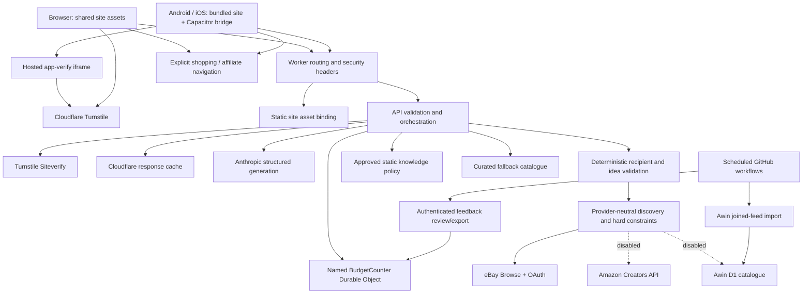
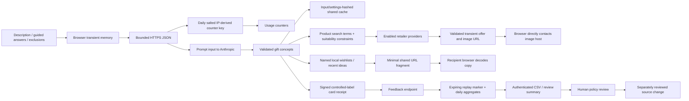

# System architecture and data flows

## Evidence and scope

Source baseline: `74a6ddf2b5855710f2a2e762b0805e57645f85c1`. See
[inventory](00-repository-inventory.md) and [test report](test-report.md).
Configuration below describes repository settings, not an attestation of the
currently deployed version, account entitlements or secret values.

## Components and trust boundaries

| Component | Responsibility / data | Boundary and controls | Failure / cost / evidence |
|---|---|---|---|
| Shared frontend | Input, deck, product presentation, storage, sharing | Treat provider/model/fragment text as untrusted; bounded storage schemas; safe DOM construction on inspected paths | Storage unavailable, corrupt payloads, stale async results; browser tests and frontend regressions |
| Capacitor bridge | Native share/clipboard/browser/back/haptics | Bundled assets, fixed HTTPS API base; iframe messages require origin **and** exact source window | Plugin, lifecycle and OS differences; source and asset sync are not device certification |
| Worker/core | Routes, bounded JSON, origin checks, input normalization | Exact origin allowlist is browser isolation, **not authentication**; administrator bearer authentication is separate | Provider errors, configuration failures, client disconnect; Node tests do not reproduce all edge semantics |
| Turnstile | Abuse challenge | Siteverify before ideas cache/paid work; required deployment configuration and host/action checks hardened in this audit | Provider availability; old clients without an action remain compatible |
| Budget object | Atomic usage reservations, feedback deduplication/aggregates | Worker binding, one named object, storage transactions | Hot-object single point of contention; local concurrency tests do not establish peak production throughput |
| Claude | One bounded structured generation request | Fixed upstream endpoint/tool schema; deterministic validation before publication | Tokens, latency, provider availability; prompts are not security boundaries |
| Response cache | Avoid repeat AI calls | Fingerprint includes input, prompt/validator/model/settings and release mode | Shared by matching inputs; not a per-user vault or PII anonymisation mechanism |
| Provider registry | Normalize offers, preserve product identity and suitability | Destination/image host checks, price/currency/condition/expiry, reserved lookup quotas | OAuth/API outages, expired listings, incomplete metadata; no actual purchase or rights verification |
| Awin D1 | Reviewed/imported catalogue rows and searchable facts | Parameterized SQL and bounded ingestion; activation and advertiser approval separate | Feed freshness, partial imports, migrations and restoration; provider disabled |
| Feedback/knowledge | Controlled labels and signed issuance receipts, aggregates, export, human review | Expiry and transactional dedupe; approved/versioned policy before reuse | Issuance is not unique-person or purchase proof; unsigned legacy usage remains weaker evidence |
| Affiliate router | Merchant-specific approved tracking or ordinary fallback | Fixed destinations/identifiers, merchant-level flags | Tracking and payout require network records; `sponsored` is disclosure metadata, not attribution proof |
| Ads/telemetry | Optional adapter hooks | Disabled public flags; configured-host policy, no recipient payload in adapter | External script privileges and consent review required before activation |
| GitHub workflows | Tests, replays, Awin maintenance, feedback notices | Read-only token by default; issue write only for notifications; actions pinned by audit | Awin scheduled workflow writes remote D1; operator controls and secret scope still matter |

## Exposed endpoint inventory

Discovered from [core routing](../../src/core.js), not documentation alone.

| Endpoint | Intended method / authority | Independent local evidence |
|---|---|---|
| `/api/health` | Public liveness | Read-only live GET 200; not a dependency or authorization check |
| `/api/ready` | Public configuration readiness | Baseline live GET 200; does not prove provider approval, secret entropy or capacity |
| `/api/ideas` | POST; origin, configuration, bounded JSON, Turnstile, quotas | Negative origin/body/verification checks; provider/cache mocks |
| `/api/products` | POST; origin, configuration, input/offer validation, quotas | Malformed input and concurrent reservations/retries; no general signed-plan authentication for legacy client inputs |
| `/api/feedback` | POST; origin, input/rate controls; signed or legacy event path | Tamper/expiry/replay/conflicting-rating tests; legacy events cannot approve knowledge |
| `/api/feedback/export` | POST; separate admin bearer token | Unauthorized/invalid body tests; no production export performed |
| `/api/knowledge/export` | POST; separate admin bearer token | Same boundary; no production data downloaded |
| `/api/feedback/review` | POST; separate admin bearer token; check/ack | Action validation; scheduled integration inspected, no remote mutation |

OPTIONS is handled separately. Public liveness routes do not have the same method
or authorization semantics as write routes. Internal Durable Object operations are
binding calls, not additional publicly routed administrator endpoints.

## Effective feature register

| Feature | Repository production configuration | Local / preview / mobile / external qualification |
|---|---|---|
| Recommendation mode | `baseline-v3.3` | Same backend for all clients; offline replay scripts exercise the experimental engine instead |
| Experimental graph/BM25/RRF/MMR engine | Implemented, not selected | Research and deterministic evaluation only; not a new quality winner |
| Knowledge reuse | Flag true | Empty/unapproved shipped policy means no current library bypass; approval and expiry still required |
| Learning ranker | False | Inactive; not activated by audit |
| Global discovery / photo-first / eBay | True / true / true | Production credentials, allocation and approvals not independently attested |
| Amazon / Awin discovery | False / false | Implemented, dormant; never activated here |
| Awin catalogue maintenance | Scheduled workflow present | Runtime discovery disabled does **not** disable scheduled remote ingestion |
| Static sponsored picks | Implementation present | Shipped examples are demo-only; demo flag false |
| Verified experiences/subscriptions | Disabled, empty inventory | Requires independently reviewed terms, prices, expiry and approval |
| Ads / external monetisation telemetry | Disabled | **Live homepage loaded Cloudflare Insights** separately; public adapter flags are not a complete analytics inventory |
| Web/native origins | Two website origins plus two exact Capacitor origins | Local fixture server substituted APIs only; it did not disable production protections |
| Preview deployment | Worker preview URLs disabled; no separate preview env block | Dashboard overrides and ad-hoc local environment variables unverified |
| Mobile configuration | Generated from shared source plus bridge/CSP | Bundled web changes require new native distribution; website deployment cannot update installed bundles |
| Embeddings/trends/occasion modes | Designed/deferred, not implemented | No vector database identified; no claim of vector-security testing |

## Structural risks

The single budget object is both the global spending boundary and a contention/
availability dependency. Anthropic is the only live-model provider, with a checked
catalogue rather than a second-model failover. Site assets and API are one Worker
release; static frontend code is shared, but installed apps are independently
versioned snapshots. Commercial and backend recipient parsing had diverged:
this audit consolidates constraints rather than adding a second recommendation
architecture. The large inline homepage script remains a maintenance and stricter
CSP migration cost; it is not, by itself, evidence of an exploitable vulnerability.
